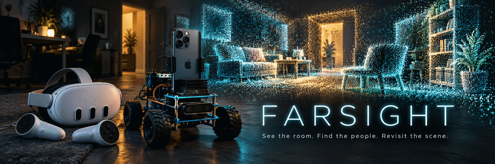
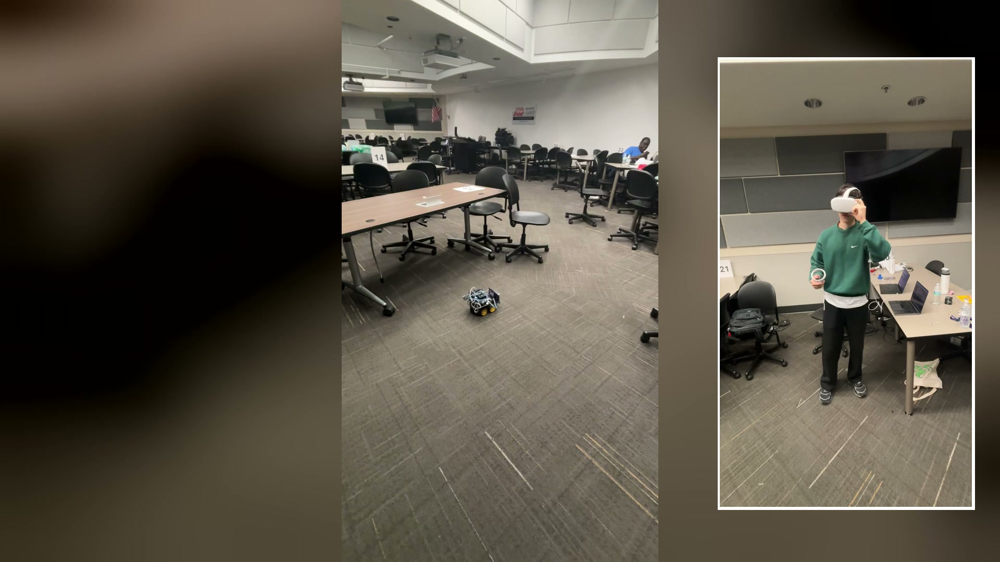
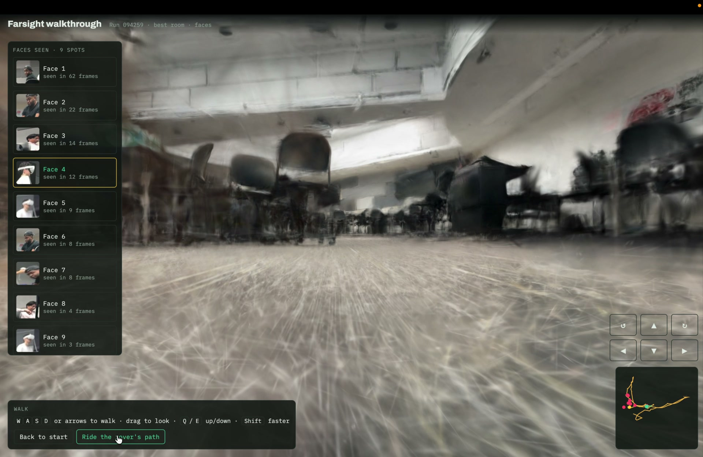
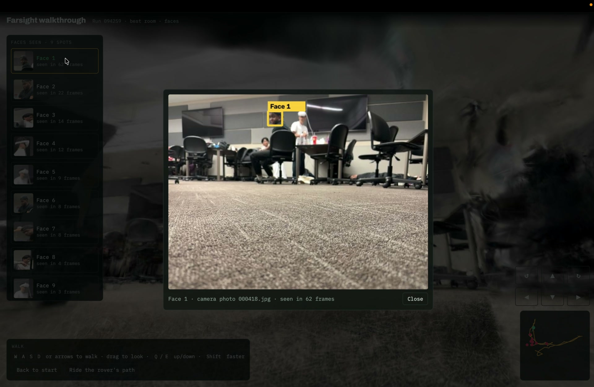

<p align="center">
  
</p>

<h1 align="center">Farsight</h1>

<p align="center">
  <strong>See the room. Find the people. Revisit the scene.</strong><br />
A rescue rover you drive from VR, with local AI and a room that stays after the drive.
</p>

<p align="center">
  <strong>Winner of four sponsor tracks at Knight Hacks IX</strong><br />
Hugging Face · NVIDIA · Encompass · Full Sail
</p>

<p align="center">
  <a href="https://youtu.be/AmrOGcTBTKU"><strong>Watch the demo ↗</strong></a> ·
  <a href="https://devpost.com/software/farsight-t4qyli">Devpost &amp; awards</a> ·
  <a href="#what-you-can-do">Capabilities</a> ·
  <a href="#the-whole-system">Architecture</a> ·
  <a href="#run-it">Run it</a> ·
  <a href="#inside-the-repo">Repo guide</a>
</p>

<p align="center"><sub>Hero: AI-generated concept art. Images below: real project footage and walkthroughs from our published Devpost gallery.</sub></p>

---

A responder should be able to inspect an unfamiliar room before entering it. Farsight puts that first look on wheels: an ELEGOO rover carries a LiDAR iPhone and an NVIDIA Jetson Orin Nano, while an operator sees and steers from a Meta Quest. Local vision and speech models help interpret what the rover sees. After the drive, a Mac turns its recorded observations into a Gaussian-splat room you can walk through, with face sightings linked back to the original camera frames.

Built in 36 hours at **Knight Hacks IX** by **Aziz Umarov, Saicharan Ramineni, Dechante (Chang), and Mehdi Chraibi**. Judged and awarded in four sponsor tracks; [the published project](https://devpost.com/software/farsight-t4qyli) records the results.

## From rover to room

[](https://youtu.be/AmrOGcTBTKU)

*Drive from the headset. The rover explores the room while the operator stays at the controls. Click to watch the demo.*

| Walk through what you captured | Return to the observation |
| --- | --- |
|  |  |
| A learned reconstruction of the real room, with the rover's route and face pins. | Select a sighting to revisit its viewpoint and inspect the boxed source photo. |

*These three images come from the [Devpost gallery](https://devpost.com/software/farsight-t4qyli). Face pins mark observed locations, not verified distinct people; moving people can leave multiple spots. The face-enabled browser walkthrough and immersive Quest splat viewer are separate views.*

## What you can do

| Experience | How it works |
| --- | --- |
| **Drive from inside the headset** | See the live camera in WebXR. The right stick drives in MANUAL; **A** switches to autonomous Explore; **B** stops and returns to MANUAL. In AUTO, the sticks move your virtual viewpoint. [Controls](quest/README.md#controls) |
| **Find people and keep the evidence** | Onboard YOLO11n-pose/TensorRT detects people. Face detection, encounter snapshots, timed rescue-drill scoring, and machine-drafted SBAR notes support review after the search. [Perception](jetson/perception.py) · [Mission log](jetson/mission.py) · [Triage](jetson/triage.py) |
| **Ask about the live view** | Hold the Quest's left trigger to ask; release to send. Whisper `base.en` transcribes, Qwen3-VL-2B-Instruct answers, and Piper speaks. The laptop also supports text and voice; preset survivor phrases are available in English and Spanish. Models run locally on the Jetson. [Assistant setup](docs/assistant-setup.md) · [Phrases](jetson/phrases.py) |
| **Build spatial context as you go** | A native Swift/ARKit app sends synchronized camera images, measured LiDAR depth, and camera poses. Live mapping retains observed geometry; optional Nav2 integration adds indoor path planning. [Capture](ios/README.md) · [Mapping](docs/mapping.md) · [Navigation](docs/navigation.md) |
| **Revisit the room after the drive** | A Mac watcher pulls finished captures, seeds Brush with measured LiDAR, trains on Metal, and publishes a Gaussian-splat room. Walk it in the browser, ride the recorded route, inspect face pins, or enter the separate Quest splat viewer. [Post-run workflow](tools/postprocess/AFTER_RUN.md) |
| **Try the software without hardware** | The simulator and recorded replay exercise the real operator app. Sources are labeled **SIMULATED** or **REPLAY**, and replay controls are inert. [Judge flow](docs/judge-demo.md) |

## Four tracks, four wins

The [Knight Hacks IX results on Devpost](https://devpost.com/software/farsight-t4qyli) list Farsight as a **winner** in each of these tracks:

| Winning track | What we built |
| --- | --- |
| **Hugging Face: Best Use of Open Source AI** | Local Qwen3-VL vision, Whisper speech recognition, and Piper speech synthesis for scene Q&A, draft notes, and spoken phrases. [Model provenance & licenses](models/README.md) |
| **NVIDIA: Best Use of Jetson Nano** | A Jetson **Orin Nano** running onboard perception, camera streaming, local AI, navigation integration, and serial motor control. [TensorRT backend](jetson/pose/trt_backend.py) · [Jetson setup](docs/jetson-bringup.md) |
| **Encompass: Data Capturing Hardware** | A rover-mounted LiDAR iPhone turns synchronized RGB, depth, and poses into encounter records and revisitable rooms. [iPhone app](ios/README.md) · [Capture archive](jetson/mapping/run_capture.py) |
| **Full Sail: Pathways & Perception, A Serious Games & Simulation Challenge** | A search-training experience combining pathfinding, person/face detection, timed rescue drills, and room walkthroughs. [Drill scoring](jetson/drill.py) · [Quest locomotion](quest/src/splat-navigation.ts) |

## The whole system

**The phone senses. The Jetson understands and drives. The Mac relays and reconstructs. The Quest puts the operator there.**

[](docs/assets/farsight-architecture.svg)

[Open the vector diagram](docs/assets/farsight-architecture.svg) · [Detailed architecture](docs/architecture.md) · [Wire contract](docs/interfaces.md)

The two kits communicate through **two phone bridges over cellular/Tailscale**. The rover phone connects locally to the Jetson over USB; the operator phone connects to the Mac through USB/iproxy. The Quest reaches the Mac relay through USB/ADB reverse. Raw camera/depth capture stays on the rover side; processed video, maps, status, and control cross the remote link. [Phone routing](docs/phone-relay.md) · [Relay](tools/operator_relay.py).

The local assistant uses **Whisper `base.en` via whisper.cpp → Qwen3-VL-2B-Instruct GGUF and its matching vision projector via llama.cpp → Piper**. YOLO11n-pose/TensorRT handles person perception. The Python server sends motor commands over USB serial to an Arduino Uno and the ELEGOO chassis. **Nav2 is opt-in**; the default server's reactive Explore/Seek policy is separate. [Model sources](models/README.md) · [Control](jetson/control/README.md) · [Navigation](docs/navigation.md).

After capture, the Mac runs **Brush/Metal training and CPU face processing in parallel**. It publishes a pruned scene for `/splat.html` on Quest and a face-enabled `walk.html` with `faces.json` and boxed camera frames. [Pipeline](tools/postprocess/after_run.py) · [Face pins](tools/postprocess/faces/face_pins.py). Live LiDAR geometry is measured; a Gaussian splat is a learned appearance model. Ordinary RGB-only iPhones provide video; measured scene depth needs a supported LiDAR iPhone. [Capture modes](ios/README.md).

## Run it

### Start with the simulator

You need **Python 3, Node.js/npm, and FFmpeg** for H.264. From a fresh checkout:

```sh
git clone https://github.com/azizu06/farsight.git
cd farsight

python3 -m venv .venv
.venv/bin/python -m pip install -r tools/requirements.txt \
  -r jetson/mapping/requirements.txt -r jetson/control/requirements.txt
npm --prefix quest ci
.venv/bin/python -m tools.demo --simulate --build --h264
```

Open **[localhost:8080](http://localhost:8080)**. On desktop, hold **Space + WASD** in the live camera view to drive. This is **SIMULATED** sensor and motor data. Recorded replay is labeled **REPLAY** and cannot drive motors. [Simulator/replay guide](docs/judge-demo.md).

### Connect the physical rig

| Hardware | Role | Start here |
| --- | --- | --- |
| **LiDAR iPhone** | Camera, measured depth, and ARKit pose on the rover | [Capture app](ios/README.md) |
| **Jetson Orin Nano** | Onboard perception, local assistant, mapping, and control | [Bring-up](docs/jetson-bringup.md) · [Inference](docs/inference-setup.md) |
| **Arduino Uno + ELEGOO chassis** | Serial motor control and the drive platform | [Firmware](rover/README.md) · [Drive calibration](docs/drive-calibration.md) |
| **Two cellular phones** | Rover/operator bridge roles over Tailscale | [Phone relay](docs/phone-relay.md) |
| **Mac + Meta Quest** | Operator relay, USB forwarding, and WebXR controls | [Transport](docs/transport-setup.md) · [Quest first run](docs/quest-first-run.md) |

Install the runtime, target-built model engines, and Arduino connection using those guides. The rig has no ultrasonic sensor or pan servo; its profile uses iPhone LiDAR and Nav2. Generic server launches need `--nav2` to enable that integration. The optional live rendered-map/stereo path has a separate [Mac renderer runbook](docs/macview-rig-acceptance.md).

Voice/VLM weights are excluded from Git. Follow the [assistant guide](docs/assistant-setup.md) to install Qwen3-VL-2B-Instruct with its matching projector, Whisper `base.en`, and Piper voices. Local inference needs no cloud API; remote operation needs the cellular connection.

The default immersive demo mode warns about stale video instead of blocking motion. `?demo=0` restores strict client guards; server/relay demo settings are separate. Permits, link-loss stops, B/STOP, and the Uno watchdog remain. [Current mode semantics](quest/README.md#controls) · [Wire contract](docs/interfaces.md).

### Turn a saved run into a room

Install Brush and the separate [face-processing environment](tools/postprocess/AFTER_RUN.md#face-pins-and-offline-walkthrough), then build the Quest app. From the repo root:

```sh
npm --prefix quest run build
.venv/bin/python -m pip install -r tools/postprocess/requirements-mac.txt
.venv/bin/python tools/postprocess/after_run.py --demo --local /path/to/saved-run \
  --dist "$PWD/quest/dist"
```

The Mac `--demo` preset selects **5,000 steps**, a capped measured LiDAR seed, and CPU face processing. The runner prints the face-enabled browser walkthrough URL and records the separate Quest scene URL in its receipt. To automate the pull/build after future captures, follow the [watcher setup](tools/postprocess/AFTER_RUN.md). [Dechante's original workflow](tools/postprocess/README.md) covers the browser walk, route minimap, ride-along, and held-out image scoring.

## The receipts

A saved **60-second / 119-photo capture sample** produced a room and its face evidence in **113.73 seconds locally on an Apple M5 Pro**. Brush took **112.19 seconds at 5,000 steps**; **61.58 seconds of CPU face processing** ran in parallel. With a 10-second idle allowance and a 0.31-second local rsync stand-in, the result was **124.04 seconds**.

These timings exclude real Jetson transfer and browser loading. The sample is a prefix of a longer saved run and reuses its measured LiDAR seed, capped to **290,811 points**; it does not reproduce the seed from a separate short drive. Build time depends on the capture, seed, settings, and concurrent GPU load. [Exact Mac receipt](tools/postprocess/MAC_RECEIPT.md#face-enabled-60-second-demo--2026-10-11-1002-edt) · [Quality and export evaluation](tools/postprocess/QUALITY_RECEIPT.md) · [Later native Mac budget experiments](tools/postprocess/qualification/mac-20261011/README.md).

For the hardware-free simulator/replay judge flow:

```sh
npm --prefix quest run test:judge
```

This validates software behavior. Physical camera-to-headset timing, controller behavior, motor response, and disconnect recovery have their own evidence in the [qualification guide](docs/pitch-metrics.md). Pruning a splat for Quest can introduce artifacts; a desktop load or training score does not establish headset quality. Compare the final viewer with its source photos.

Farsight is a hackathon prototype for search training. Detection boxes, face spots, and machine-drafted SBAR notes are observations for human review. [Fallback playbook](docs/fallback-playbook.md).

## Inside the repo

| Area | Entry point | Guide |
| --- | --- | --- |
| **iPhone capture & bridges** | `ios/` | [Swift/ARKit capture](ios/README.md) · [Phone relay](docs/phone-relay.md) |
| **Rover backend** | `python -m jetson.server` → `jetson/mapping/server.py` | [Bring-up](docs/jetson-bringup.md) · [Assistant](docs/assistant-setup.md) |
| **Quest operator & splat viewer** | `quest/src/main.ts`, `quest/src/rover.ts` | [App and controls](quest/README.md) · [First run](docs/quest-first-run.md) |
| **Operator transport** | `tools/demo.py`, `tools/operator_relay.py` | [Transport](docs/transport-setup.md) · [Link lab](docs/link-lab.md) |
| **Post-drive rooms & face pins** | `tools/postprocess/after_run.py`, `walk.html` | [Mac automation](tools/postprocess/AFTER_RUN.md) · [Original pipeline](tools/postprocess/README.md) |
| **Mapping & navigation** | `jetson/mapping/`, `ros2/farsight_nav/` | [Dense mapping](docs/dense-map.md) · [Scan](docs/scan.md) · [Nav2](docs/navigation.md) |
| **Motors & hardware** | `rover/`, `jetson/control/`, `hardware/print/` | [Motor control](jetson/control/README.md) · [Printed mounts](hardware/print/README.md) |
| **Models & alternate runtime** | `models/`, `rust/` | [Model sources/licenses](models/README.md) · [Rust parity](rust/README.md) |
| **Shared contracts** | `docs/` | [Architecture](docs/architecture.md) · [Wire format](docs/interfaces.md) |

## Built by

[**Aziz Umarov**](https://devpost.com/azizu06) · [**Saicharan Ramineni**](https://devpost.com/GodlyDonuts) · [**Dechante (Chang)**](https://devpost.com/chang-pro) · [**Mehdi Chraibi**](https://devpost.com/chraibimehdi11)

Inspired by our earlier [PIP / Personal Intelligent Pathfinder](https://github.com/azizu06/pip-scout) project. Dechante's posed-photo/LiDAR-seeded Brush method, fast step-budget experiments, walk viewer, and face-pin workflow underpin the post-run experience.

Farsight builds on **Brush, Three.js, WebXR, Spark, ARKit, ROS 2/Nav2, Ultralytics YOLO, llama.cpp, whisper.cpp, Piper**, and models distributed through **Hugging Face**. [Pipeline attribution and results](tools/postprocess/README.md) · [Model provenance and licenses](models/README.md).

<p align="center"><strong>One drive. A live view. A room you can return to.</strong></p>
