# Farsight

Judging: [90 s demo](docs/judge-demo.md), [fallback playbook](docs/fallback-playbook.md), [architecture](docs/architecture.md), [Devpost evidence](docs/devpost-checklist.md), [Devpost draft](docs/devpost-draft.md).

[](docs/architecture.md)

Optional camera-only room snapshot: [scan setup, model contract and local evidence](docs/scan.md).

See, steer, and search through a rover's camera from a Quest 2. The Jetson Orin
Nano runs perception, motor safety, and mission recording. A MacBook serves the
Quest app over USB. The confirmed [phone-owned cellular relay](docs/phone-relay.md)
connects the two iPhones, with local USB bridges to the computers; implementation
and hardware qualification are in progress. The earlier computer-side
Tailscale/USB-tether path remains a fallback. Venue Wi-Fi is not part of the design.

The software includes JPEG/H.264 video, trigger/stick driving, servo or digital
pan, person/pose/optional face detection, rescue drills, mission reports, and an
optional local voice/vision assistant. A LiDAR-capable iPhone supplies measured
RGB-D for 3D reconstruction and VR inspection. An ordinary iPhone supplies RGB
without fabricated depth. The real Quest, Jetson, phones, and motor hardware
still need the on-rig qualification checks ([docs/hardware-preflight.md](docs/hardware-preflight.md)).

## Rehearse on the MacBook

Python 3.10+ and Node 20.19+ or 22.12+. Install while internet is available:

```sh
python3 -m venv .venv
.venv/bin/python -m pip install -r jetson/mapping/requirements.txt -r jetson/control/requirements.txt -r tools/requirements.txt
npm --prefix quest ci
npm --prefix quest run build
.venv/bin/python -m tools.demo --simulate --h264
```

Open **http://localhost:8080**. Hold Space and use WASD in Live rover; release to
stop. Enable H.264 in settings after the encoder is ready. JPEG is the initial
compatibility mode; the server flag alone does not switch the viewer. FFmpeg is
required for H.264. Camera, geometry, and rover telemetry are labelled SIMULATED;
the virtual rover exercises control policy, not calibrated vehicle physics.
Add `--quest` when the headset is connected and USB debugging is authorized.

## Start the real rover

On the Jetson, create the environment with `--system-site-packages` to retain
JetPack's TensorRT bindings, then install the runtime requirements above. Build
or copy `quest/dist` on the MacBook for the operator relay. Flash the
[Uno firmware](rover/README.md) and perform wheels-raised direction, range,
watchdog, power, and PWM checks before enabling floor driving.

```sh
.venv/bin/python -m jetson.server --camera 0 --serial-port /dev/ttyACM0 --h264 --mission-dir missions
```

Physical motors require an explicit serial port. Simulation is opt-in and cannot
be combined with physical motors. Calibrate `--min-pwm` and `--max-pwm` against
real motor stiction and speed. Missing cameras stay unavailable, so they cannot
silently drive the real car using a simulated view.

For phone capture, omit `--camera` and install the original
[Farsight Capture app](ios/README.md). It sends RGB or measured LiDAR RGB-D over
the phone's local USB network. Enter the Jetson's actual USB-interface IP in the
app; pairing and local routing must be tested on the rig. Existing Pip Scout
RGB-D packets remain protocol-compatible; the new app is independent.

First-time Jetson setup, from the laptop to a green `/health`, is the ordered runbook in
[docs/jetson-bringup.md](docs/jetson-bringup.md). Prepare models on the laptop before going offline:

```sh
python3 -m tools.export_detector --weights yolo11n.pt
python3 -m tools.export_detector --weights yolo11n-pose.pt
python3 -m tools.fetch_models                  # Piper English + Spanish voices, face model, whisper (--groups vlm-qwen3 for the Qwen3-VL-2B assistant model)
bash tools/push_models.sh USER@JETSON
```

Export dependencies are laptop-only. Build TensorRT engines with `python -m jetson.build_engine models/yolo11n-pose.onnx` on the actual Jetson
as described in [inference setup](docs/inference-setup.md). Add
`--detector-model models/yolo11n.engine` for GPU object detection, or
`--detector pose --detector-model models/yolo11n-pose.engine` for GPU pose.
ONNX files provide CPU rehearsal. HOG is a bundled CPU fallback, not evidence
of GPU execution. The optional [Hub face detector](models/README.md) uses
`--face-model models/version-RFB-320.onnx` and currently runs on CPU.

## Connect the operator

Authenticate Tailscale on the Jetson and MacBook and verify cellular USB tethering
at both ends. Use the actual rover address:

```sh
.venv/bin/python -m tools.demo --upstream http://JETSON_TAILNET_IP:8443 --quest
```

This explicit HTTP example travels inside the encrypted Tailscale tunnel.
HTTPS upstream is supported with certificate verification and `--ca-file`.
Open `http://localhost:8080` in Quest Browser. Right trigger is the deadman and the
left stick drives. Right A switches camera/map, right B stops, left X recenters,
left Y opens the actions menu (point and right grip to select),
left grip starts the rescue drill, and the left trigger confirms a pending
assistant proposal (it asks by voice only when the rover has a Whisper model). The [Quest controls](quest/README.md#controls) are
authoritative. Choose full-frame fixed mode for a fixed camera; servo pan requires
a working camera mount.

The Jetson stops on its 250 ms permit lease; the Uno has a separate 300 ms
watchdog. Stale video or reconnection requires releasing and pressing again.
Explore/Seek policies also require held, fresh operator commands and valid range;
qualify those modes separately. See the [operator hardware runbook](docs/transport-setup.md),
[Quest checklist](quest/README.md), and [systemd checklist](docs/demo-checklist.md).

## Local assistant and evidence

Text questions work from observed detections without a language model. Optional
local llama-server, whisper-cli, and Piper enable image questions, microphone
transcription, and spoken answers; see [assistant setup](docs/assistant-setup.md).
Answers never execute motor actions. Missing audio models leave text available
and return an explicit audio error. Rescue counts describe observed tracks,
not verified distinct people. `--mission-dir` persists bounded detection snapshots;
otherwise the report clearly identifies in-memory evidence.

## Measured numbers

Simulated column: `python -m tools.pitch_metrics` against `jetson.server --demo
--simulate-rover --h264` on a laptop (2026-10-10, 20 s per phase, real FFmpeg,
HOG fallback detector, simulated camera and rover). These show the tool and the
software path work; they are not rig figures. The rig column is filled from
[docs/pitch-metrics.md](docs/pitch-metrics.md) once the rover is assembled.

| Metric | Simulated (laptop) | Rig | How measured |
|---|---|---|---|
| Detector fps | 3.0 fps (HOG fallback) | pending rig run | median of `/health.detector_fps` every 0.5 s, `tools.pitch_metrics` |
| Stream fps, MJPEG | 14.7 fps | pending rig run | frames parsed from `/stream.mjpg`, 20 s |
| Stream fps, H.264 | 9.8 fps | pending rig run | frames in `/ws/video` segments, 20 s |
| Control round-trip p50 / p95 | 23.9 / 52.6 ms | pending rig run | stopped `/ws/control` probes at 10 Hz under video load |
| Permit age at send p50 / p95 | 31.2 / 51.0 ms | pending rig run | age of newest received permit per probe; limit 250 ms |
| Glass-to-glass latency | not applicable | pending rig run | stopwatch filmed through the system, median of 10 |
| Stop distance after deadman release | not applicable | pending rig run | tape-marked floor, side video, 5 trials |

## Verification and limits

Run `.venv/bin/python -m pytest jetson tools/tests ios/tests -q` after installing
`pytest` and the test requirements, then `npm --prefix quest test` and
`npm --prefix quest run build`. Native interop checks require Swift. The complete
[phone project](ios/FarsightCapture.xcodeproj) builds in Xcode; installation needs
your signing team. Software tests do not establish physical readiness.

Run `tools.qualify_link` with the Quest page closed: control has one owner.
Measure actual displayed video delay, power behavior, and motor stop times on
the full rig. [Network fault injection](tools/fault_proxy.py) can rehearse delay,
bandwidth limits, and disconnection locally. Start cellular video at 500 kbps,
10 fps; tune only against measured latency and spare upload capacity.

The [wire contract](docs/interfaces.md), [mapping protocol](docs/mapping.md), and
[cellular design](docs/demo-connectivity.md) describe the routes. Local models
can run offline; remote cellular viewing requires cellular internet. No usable
wireless path means no live untethered video: stop and show labelled retained
data or simulation. The parallel Rust implementation is preserved under `rust/`;
check its current feature and protocol parity before switching the demo runtime.

YOLO artifacts use the applicable Ultralytics AGPL-3.0/license terms. The optional
UltraFace Hub model has an MIT model card and Apache-2.0 Hub metadata; preserve
both provenance records in [models/README.md](models/README.md).
