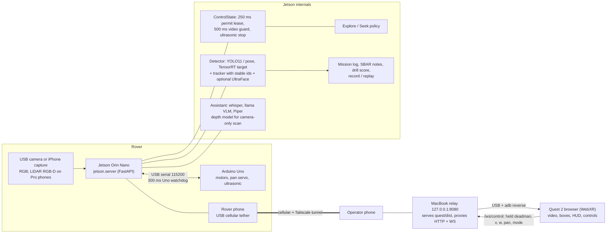

# Architecture, in one page (#43)

Farsight puts an operator inside a rover: Quest 2 for sight and steering, a Jetson Orin Nano on
the rover for perception, safety and logging. Wire details are in [interfaces.md](interfaces.md);
this page is the explanation for judges and the Devpost diagram.

## How a frame becomes an action

1. **Camera to Jetson.** One frame source at a time (USB camera, `/phone/rgb`, replay, or the
   explicit simulator). A missing real camera never falls back to a simulated one.
2. **Perception on the rover.** The detector runs on the Jetson (TensorRT engine on target; ONNX
   or HOG as labelled CPU fallbacks). A small tracker keeps ids through brief dropouts and never
   reuses one; pose adds 17 keypoints and a `down` flag.
3. **Video + boxes stay matched.** The headset draws boxes only on the frame whose id they belong to
   (JPEG id, or H.264 per-sample capture ids). Unmatched boxes are omitted, never guessed.
4. **Quest to rover.** The headset sends control at 20 Hz while the right trigger is held, echoing a
   server-issued permit. The permit expires 250 ms after issue; the Uno separately zeros the motors
   after 300 ms of silence. Stale video, disconnect, or a lost controller stops the rover and
   requires a release and new press.
5. **Autonomy is a policy on the same lease.** Explore and Seek are computed on the Jetson from
   detections and ultrasonic range. They never renew a permit themselves; stick input overrides them.
6. **Evidence.** Detections, snapshots, range, drill results and SBAR notes go into the mission
   report where the sensors are. `--record` saves a run that `--replay` plays back with REPLAY badges
   and inert controls.
7. **Local assistant.** `/ask` answers from live detections, with an optional local VLM, Whisper and
   Piper. It cannot move motors; a proposed Seek or Scan needs a confirm *and* a held trigger.

## What is deliberately not clever

- Safety lives on the robot (lease, ultrasonic stop, Uno watchdog), not in the headset or the network.
- The network is two cellular tethers and a Tailscale tunnel. Models run offline; the *link* needs
  cellular internet. No path means no untethered live video; we then show labelled recordings.
- Geometry has three labelled kinds: **measured** (LiDAR iPhone, ARKit pose), **estimated**
  (monocular Depth Anything V2, five-view stationary scan, optical-axis metres) and **none** (ordinary
  iPhone or webcam: RGB only). The viewer and docs never present estimated depth as measured.
- Rust (`rust/`) is a parallel port with the same wire contract. It lacks replay and may lag the
  newest Python routes; the Python server is the demo runtime until parity is checked.

## Pointers

| Topic | Doc |
|---|---|
| Wire contract | [interfaces.md](interfaces.md) |
| Cellular + Tailscale plan | [demo-connectivity.md](demo-connectivity.md), [transport-setup.md](transport-setup.md) |
| Jetson bring-up | [jetson-bringup.md](jetson-bringup.md), [inference-setup.md](inference-setup.md) |
| Mapping (LiDAR) / scan (camera-only) | [mapping.md](mapping.md), [scan.md](scan.md) |
| Assistant + triage + phrases | [assistant-setup.md](assistant-setup.md) |
| Software measurements | [qualification-results.md](qualification-results.md), [ui-validation.md](ui-validation.md) |
