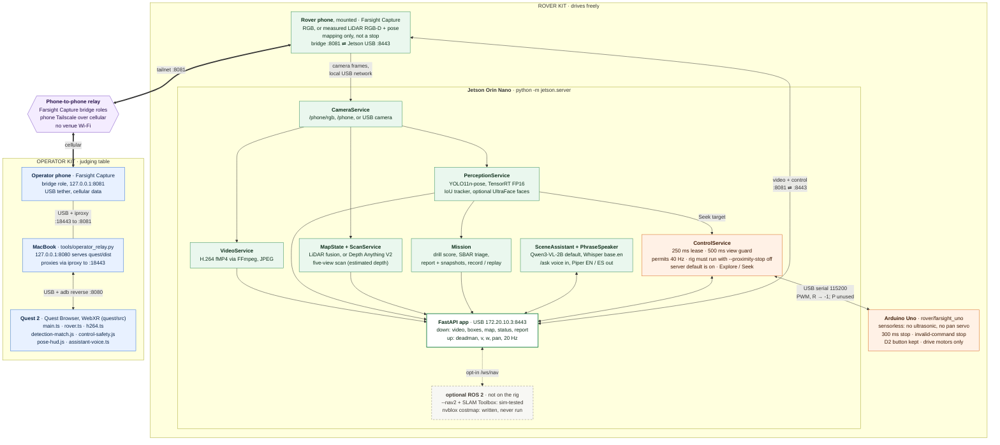

# Architecture, in one page (#43, #15)

Farsight puts an operator inside a rover: Quest 2 for sight and steering, a Jetson Orin Nano on
the rover for perception, safety and logging. There are two physical kits. The **operator kit**
(Quest 2, MacBook relay, operator phone) sits with the judges; the **rover kit** (Jetson, mounted
phone camera, sensorless Uno, drive motors) drives freely. The production link is the
phone-to-phone relay: Farsight Capture bridge roles over the two phones' cellular/Tailscale,
with Quest↔Mac, Mac↔operator phone, and rover phone↔Jetson on local USB. Campus Wi-Fi is not part
of the production route. A live two-phone transport run is recorded, while full Quest display,
physical driving, and failure recovery still need on-rig qualification. The computer-side
Tailscale/USB-tether path is a fallback only. Wire details are in [interfaces.md](interfaces.md);
this page is the explanation for judges and the Devpost diagram.

Rendered for slides and Devpost: [architecture.png](assets/architecture.png) (`-w 2400`, natural size),
[architecture.svg](assets/architecture.svg). Source: [assets/architecture.mmd](assets/architecture.mmd);
re-render both after editing it with
`npx -y @mermaid-js/mermaid-cli@11.12.0 -i docs/assets/architecture.mmd -o docs/assets/architecture.svg -b white`
and `npx -y @mermaid-js/mermaid-cli@11.12.0 -i docs/assets/architecture.mmd -o docs/assets/architecture.png -b white -w 2400`.

## How a frame becomes an action

1. **Camera to Jetson.** One frame source at a time (USB camera, `/phone/rgb`, replay, or the
   explicit simulator). A missing real camera never falls back to a simulated one.
2. **Perception on the rover.** The detector runs on the Jetson (TensorRT engine on target; ONNX
   or HOG as labelled CPU fallbacks). A small tracker keeps ids through brief dropouts and never
   reuses one; pose adds 17 keypoints and a `down` flag.
3. **Video + boxes stay matched.** Each detection packet carries the capture id of its frame (JPEG
   id, or H.264 per-sample capture ids). The headset draws the exact match, or the newest packet from
   the same source within 8 frames, faded by its lag; anything older is dropped, never guessed
   ([PR #66](https://github.com/azizu06/farsight/pull/66)).
4. **Quest to rover.** The headset sends control on a 20 Hz timer, plus one extra send as soon as a
   new permit arrives, while the right trigger is held. The server issues permits every 25 ms (40 Hz);
   each permit expires 250 ms after issue. The Uno separately zeros the motors after 300 ms of
   silence, on an invalid command, and while the D2 button is held. Stale video, disconnect, or a
   lost controller stops the rover and requires a release and new press.
5. **Autonomy is a policy on the same lease.** The default Explore and Seek policies
   (`jetson/autonomy.py`) get no range: Explore does timed turns, Seek guesses distance from the
   person-box width. They never renew a permit themselves; stick input overrides them. iPhone LiDAR
   is the only obstacle source: MapState fuses it into the voxel map, and optional Nav2 builds its
   costmaps from that depth and plans around obstacles. Losing the depth also stops Nav2 (a sensor
   fault, not a teleop stop). SLAM Toolbox can correct that path; both are simulation-tested, not the
   demo default. An nvblox costmap is written but has never run — checked on a Mac, not installed.
6. **Evidence.** Detections, snapshots, drill results and SBAR notes go into the mission report
   where the sensors are. The Uno always answers `R -1`, so there is no range evidence. `--record`
   saves a run that `--replay` plays back with REPLAY badges and inert controls.
7. **Local assistant.** `/ask` answers from live detections, with Qwen3-VL-2B as the default local
   VLM (when its pair is complete), Whisper `base.en`, and Piper. It cannot move motors; a proposed
   Seek or Scan needs a confirm *and* a held trigger.

## What is deliberately not clever

- The server's proximity stop defaults **on** (`--proximity-stop`, blank `FARSIGHT_PROXIMITY_STOP`).
  The rig must run with `--proximity-stop off`: the Uno is sensorless, so `R` always replies `-1`,
  and left on that reply reads as a stale range and blocks forward. With it off, the only
  obstacle check, `range_unsafe()` in `jetson/control/state.py`, is false, and nothing in
  `jetson/control/` reads LiDAR depth. What still stops the rover: the 250 ms lease, the 500 ms
  view guard, the pan rule (forward blocked while `|pan| > 10`), the Uno 300 ms watchdog (also on
  an invalid command, and while D2 is held), and the operator. On the optional Nav2 path, LiDAR
  depth is the obstacle source (the costmaps plan around it) and a missing depth stops that mode;
  Nav2 and SLAM Toolbox are simulation-tested, and nvblox has never run. The Uno has no ultrasonic
  and no pan servo.
- The production network is the [phone-owned relay](phone-relay.md): Quest `localhost:8080`
  through USB/ADB reverse to the Mac, USB `iproxy` to the operator phone, cellular/Tailscale
  to the rover phone, then local USB to Jetson `:8443`. Campus Wi-Fi is not in this path.
  Models run offline; remote viewing needs cellular internet. The full Quest/drive/fault-recovery
  rehearsal is still pending. The computer-side Tailscale path is fallback only; if live paths
  fail, show labelled recordings with motors disabled.
- Geometry has three labelled kinds: **measured** (LiDAR iPhone, ARKit pose), **estimated**
  (monocular Depth Anything V2, five-view stationary scan, optical-axis metres) and **none** (ordinary
  iPhone or webcam: RGB only). The viewer and docs never present estimated depth as measured.
- Rust (`rust/`) is a parallel port with the same wire contract. It implements replay (`--record`/`--replay`) but may lag the
  newest Python routes; the Python server is the demo runtime until parity is checked.

## Pointers

| Topic | Doc |
|---|---|
| Wire contract | [interfaces.md](interfaces.md) |
| Phone relay + cellular plan | [phone-relay.md](phone-relay.md), [demo-connectivity.md](demo-connectivity.md), [transport-setup.md](transport-setup.md) |
| Jetson bring-up | [jetson-bringup.md](jetson-bringup.md), [inference-setup.md](inference-setup.md) |
| Mapping (LiDAR) / scan (camera-only) | [mapping.md](mapping.md), [scan.md](scan.md) |
| Optional Nav2 / SLAM (sim only); nvblox written, never run | [navigation.md](navigation.md), [nvblox.md](nvblox.md) |
| Assistant + triage + phrases | [assistant-setup.md](assistant-setup.md) |
| Software measurements | [qualification-results.md](qualification-results.md), [ui-validation.md](ui-validation.md) |
