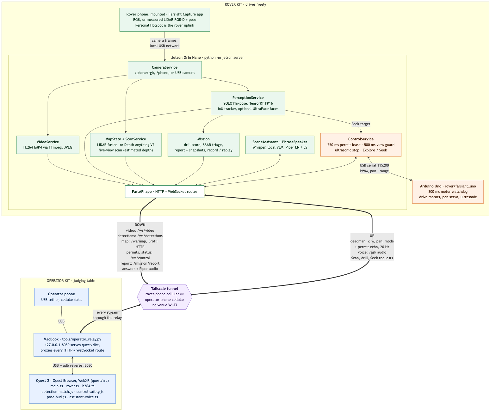

# Devpost draft (#15)

Working text for the Knight Hacks IX submission, due **Sun Oct 11, 10:00 AM** (rules:
[hackers-guide.md](hackers-guide.md)). Paste sections into Devpost once the TODOs are resolved.
Claim status lives in [devpost-checklist.md](devpost-checklist.md); this page is the prose.

Every number carries a tag:

- **[HW]** measured on real hardware, with the board or device named.
- **[SIM]** measured in software on a Mac with simulated or recorded inputs.
- **[TODO-RIG]** only a number from the assembled rig will do. Replace it, or delete the sentence.

Before submitting, search this file for `TODO` and resolve every hit. Do not upgrade a [SIM]
number to a hardware claim, and if the demo ends up running a fallback tier
([fallback-playbook.md](fallback-playbook.md)), say which tier in "What it does".

---

## Tagline (200 characters max)

Put on a Quest 2 and become the rover: live head-coupled video, on-robot AI that finds people,
and safety that lives on the Jetson, all over a cellular link.

## Inspiration

Before a firefighter, inspector or rescuer walks into a smoke-filled room or a damaged building,
someone has to guess what is inside. Small scout drones help, but most of them show a flat video
feed on a phone, and the useful part (who is in there, where, and whether they are moving) is left
to the person squinting at the screen. We wanted the opposite: an operator who feels like they are
standing where the robot stands, with the robot itself doing the looking for people and refusing
to do anything unsafe. The scout drone in Rainbow Six Siege was the mental model, and training for
real search scenarios was the reason to build it.

## What it does

Farsight is a ground rover you inhabit from a Quest 2.

- **See.** The rover's phone camera streams to the headset as H.264 video. Turn your head and the
  pan servo turns the camera with you.
- **Drive.** Hold the right trigger and push the stick. Let go and the rover stops. The trigger is a
  deadman: the Jetson issues a short permit that the headset must keep echoing, so a dropped link,
  a stale picture or a lost controller all end in a stop that needs a fresh press to clear.
- **Find people.** A YOLO11 pose model on the Jetson boxes every person, tracks them with stable
  ids, and flags someone who appears to be lying down. Boxes are drawn on the video frame they were
  computed from, or faded when they lag behind it.
- **Run a rescue drill.** A 90-second training scenario: find the "victims" (a face held in view
  for one second counts), avoid emergency stops, and get a score plus an approximate route home.
- **Ask the rover.** Push to talk: "what do you see?" Whisper transcribes it on the rover, a small
  local vision-language model answers from the live detections, and Piper speaks the answer. The
  assistant can propose Seek or Scan, but cannot move the motors on its own; a proposal needs a
  confirm and a held trigger.
- **Scan the room.** The rover stops, looks in five directions, and Depth Anything V2 turns each
  view into estimated metric depth. You stand inside the resulting point cloud in VR. With a
  LiDAR iPhone as the camera, the map uses measured depth instead, and the viewer labels which one
  you are looking at.
- **Explore and Seek.** Explore wanders until it finds a person; Seek drives toward a selected
  target. Both run on the Jetson under the same permit and stop at the ultrasonic limit.
- **Leave a record.** Every encounter goes into a mission report with time, snapshot, range, and an
  SBAR triage note (Situation, Background, Assessment, Recommendation) drafted on the rover. Runs
  can be recorded and replayed with a REPLAY banner and inert controls.

No venue Wi-Fi is needed. The two kits talk over a Tailscale tunnel carried by two phones'
cellular data, and every model runs locally on the rover.

TODO-DEMO: one sentence on which tier was shown live (full rig, bench rig, or labelled replay).

## How we built it

The diagram and a written walkthrough are in [architecture.md](architecture.md).

**Two kits.** The operator kit is a Quest 2, a MacBook and a phone. The MacBook runs
`tools/operator_relay.py`, which serves the bundled headset app on `127.0.0.1:8080` and proxies
every HTTP and WebSocket route to the rover; `adb reverse` carries that port to the Quest over USB,
so Quest Browser sees a local secure origin and can enter WebXR. The rover kit is a Jetson Orin
Nano, a phone mounted on the chassis as the camera, and an Arduino Uno that drives the motors, the
pan servo and the ultrasonic sensor. The phone tethers to the Jetson over USB, which gives it both
a local camera link and a cellular uplink. Tailscale on the MacBook and the Jetson joins the two.

**On the Jetson** (`python -m jetson.server`, FastAPI):

- `CameraService` takes frames from our iOS capture app (`/phone/rgb` for RGB, `/phone` for LiDAR
  RGB-D with ARKit pose) or a USB camera. A missing camera stays missing; it never falls back to a
  simulated one.
- `VideoService` encodes fragmented-MP4 H.264 with FFmpeg and tags every sample with its capture
  id, so the headset can match detections to frames.
- `PerceptionService` runs YOLO11n-pose through a TensorRT FP16 engine built on the board, an IoU
  plus velocity tracker, and an optional UltraFace pass for the drill.
- `ControlService` owns safety: a 250 ms permit lease, a 500 ms stale-view guard, the ultrasonic
  stop, and the Explore and Seek policies. It talks to the Uno over USB serial, and the Uno firmware
  independently zeros the motors after 300 ms without a command.
- `MapState` and `ScanService` fuse LiDAR frames or run the five-view Depth Anything V2 scan.
- `Mission`, the drill scorer and `TriageService` write the report; `SceneAssistant` and
  `PhraseSpeaker` run the voice loop with whisper.cpp, llama.cpp and Piper (English and Spanish).

**In the headset** (`quest/src`, TypeScript, Three.js, Vite): WebXR rendering of the video texture,
H.264 decode, frame-matched detection boxes and pose skeletons, the deadman and controller-tracking
safety, a LIVE / SIMULATED / REPLAY source banner, the drill HUD, push-to-talk, and a stop-reason
panel that tells the operator why the rover stopped and how to recover.

**Getting it to fit a phone connection.** We built a fault proxy and link-budget harness
(`tools/qualify_link.py`, `tools/budget_link.py`) that runs the real server, real FFmpeg and real
pose inference behind a bandwidth cap and added delay. It showed that raw map points, not video,
were what saturated a 2 Mbps link, so the viewer now pauses map transfers while you drive and pulls
compressed snapshots when you stop.

**How we checked it.** `npm --prefix quest run test:judge` drives the whole judge flow in a real
browser against the simulator and the replay fixture. Python tests cover the control state, tracker,
pose decode, drill, scan and assistant. Rust (`rust/`) is a parallel port of the server with the
same wire contract; the Python server is what we demo.

## Challenges we ran into

- **Safety that survives a bad network.** A deadman over cellular is only as good as its worst
  pause. Early runs expired the lease during short server or client stalls. We kept the 250 ms
  permit and fixed the causes instead: status-triggered command sends, a bounded CPU thread pool for
  pose inference, and decoupled camera capture from map fusion. Each change is measured in
  [qualification-results.md](qualification-results.md), including the runs that still failed.
- **Boxes on the wrong frame.** With the detector slower than the camera, exact frame matching drew
  boxes on about one frame in five. The viewer now uses the newest same-source result within eight
  frames and fades it by its lag ([PR #66](https://github.com/azizu06/farsight/pull/66)).
- **Bandwidth.** The 3D map alone needed more than a 2 Mbps link
  ([PR #67](https://github.com/azizu06/farsight/pull/67)). The fix was scheduling, not lower video
  quality.
- **Bringing up the Jetson.** The board needed USB recovery before it would boot
  ([jetson-recovery-results.md](jetson-recovery-results.md)), and NVIDIA's FFmpeg build ships
  without libx264, so we installed a private software encoder next to it
  ([jetson-runtime-results.md](jetson-runtime-results.md)).
- **Honest depth.** A depth model makes a convincing point cloud whether or not it is right. We
  label estimated and measured geometry separately all the way to the headset.

TODO-RIG: add the hardest real-rig problem (motor stiction, power under load, phone routing) once
it has happened.

## Accomplishments that we're proud of

- **TensorRT pose on the actual Jetson Orin Nano [HW]:** the YOLO11n-pose engine ran at a median
  15.29 ms and p95 18.83 ms per raw inference (20 zero-input runs, while other builds were running on
  the board), and found 4 people in a real public photo
  ([board post](https://github.com/azizu06/farsight/issues/24#issuecomment-6097633513)). This is
  model inference time only, not camera-to-headset latency.
- **The rover's software stack runs on the board [HW]:** H.264 encode, the phone-protocol frame path,
  Piper speech and Whisper transcription, CUDA initialisation, and the depth model under ONNX Runtime
  ([jetson-runtime-results.md](jetson-runtime-results.md)). These are component checks with a static
  photo and generated speech, not the full rig.
- **Stops that do not depend on the headset [SIM]:** killing the encoder stopped the simulated rover
  in 169 ms, pausing the video consumer in 333 ms, and cutting every connection in 43 ms
  ([qualification-results.md](qualification-results.md)). TODO-RIG: real stop time on the floor,
  from releasing the trigger to wheels stopped.
- **Driving fits a 2 Mbps link [SIM]:** with the deadman held, moving-frame delivery went from 0% to
  100% and video receipt p95 from about 1.1 s to about 310 ms, at 100 ms simulated round trip
  ([PR #67](https://github.com/azizu06/farsight/pull/67)). Not a real cellular measurement.
  TODO-RIG: the same numbers over the two phones and Tailscale with venue Wi-Fi off.
- **Pose inference on a CPU budget [SIM]:** bounding the ONNX thread pool cut server CPU by roughly
  46-74% in the non-stalled trials on a Mac
  ([PR #49](https://github.com/azizu06/farsight/pull/49), [qualification-results.md](qualification-results.md)).
- **A judge flow that tests itself [SIM]:** 13 steps from page load through drive, Explore, Seek,
  drill, Ask, report, scan and replay pass in a real browser
  ([PR #65](https://github.com/azizu06/farsight/pull/65)).
- **A local assistant [SIM]:** about 0.7-0.9 s per warm answer with Qwen2.5-VL-3B on a Mac GPU, and
  about 1.0 s per SBAR note ([PR #31](https://github.com/azizu06/farsight/pull/31),
  [PR #35](https://github.com/azizu06/farsight/pull/35)). TODO-RIG: the same on the Jetson GPU.
- **A five-view 3D scan [SIM]:** 596.5 ms on a Mac CPU for 89,967 points, from synthetic input
  ([scan.md](scan.md)). Estimated depth; accuracy on a real room is not measured.
- TODO-RIG: end-to-end detection fps on the Jetson while streaming video and accepting control.
- TODO-RIG: camera-to-headset latency, with how it was measured.

## What we learned

- Put safety on the robot. The headset and the network are the parts most likely to fail, so the
  rover has to stop by itself when they do. Three independent timers (permit, stale view, Uno
  watchdog) were easier to reason about than one clever one.
- Measure before tuning. The bandwidth problem turned out to be the map, not the video, and a lease
  failure turned out to be a stalled thread pool, not the timeout value.
- Label everything. SIMULATED, REPLAY, estimated and measured badges cost little and stopped us
  from fooling ourselves during rehearsals.
- TODO-TEAM: one personal line per teammate, in their own words.

## What's next for Farsight

- Close the hardware gates: floor driving with real stop timing, both phone tethers over cellular,
  and power under load.
- Measured 3D maps from a LiDAR iPhone on the rover while it drives, instead of a stationary scan.
- Run the whole voice loop on the Jetson GPU and give the assistant memory of where people were.
- A second rover, and handing control between operators.

## Built with

Python, FastAPI, NVIDIA Jetson Orin Nano, TensorRT, CUDA, ONNX Runtime, OpenCV, FFmpeg (libx264),
Ultralytics YOLO11 (pose), UltraFace, Depth Anything V2, Qwen2.5-VL and SmolVLM (GGUF), llama.cpp,
whisper.cpp, Piper, Hugging Face Hub, TypeScript, WebXR, Three.js, Vite, Playwright, Meta Quest 2,
Swift, ARKit, Arduino (C++), Tailscale, adb, Rust.

Repository (must be **public** at submission): https://github.com/azizu06/farsight

Licences to mention: YOLO artifacts are Ultralytics AGPL-3.0; UltraFace and other models per
[models/README.md](../models/README.md).

---

## Screenshot shot list

Capture at least the first five. Name files `devpost-NN-short-name.png` and keep originals.
Simulated or replayed shots must keep their SIMULATED or REPLAY banner in frame; never crop it out.

| # | What | Where to capture it | Label |
|---|---|---|---|
| 1 | Architecture diagram | [assets/architecture.png](assets/architecture.png), already rendered | n/a |
| 2 | Headset view: live video with person boxes and a pose skeleton | Quest 2 casting or the headset's screenshot, on the rig. Fallback: desktop viewer at `http://localhost:8080` from `.venv/bin/python -m tools.demo --simulate --h264` | Live, or SIMULATED banner visible |
| 3 | Deadman stop: stop-reason panel after releasing the trigger | Same viewer, release mid-drive | Same |
| 4 | Rescue drill HUD: timer, found count, score, route home | Drill started from the headset (left grip) or the desktop Drill control | Same |
| 5 | Mission report with snapshots, range and an SBAR note | `GET /mission/report` page from the relay, after a drill | Same |
| 6 | 3D scan point cloud, ideally inside VR | Press Scan with `--depth-model` set ([scan.md](scan.md)) | "estimated depth" must be visible |
| 7 | Assistant: question and spoken answer on screen | Push-to-talk in the headset, or the desktop Ask box | Same |
| 8 | The rover itself: Jetson, mounted phone, Uno, motors | Photo of the assembled rig | Real hardware |
| 9 | The operator kit: Quest, MacBook, phone on the table | Photo at the venue | Real hardware |
| 10 | Jetson terminal proving on-board inference | SSH session showing the TensorRT engine run and `/health` | Real hardware |

## Sponsor tracks to opt into

Opt into each on Devpost, then book that sponsor's judging room. General tracks are automatic.

- **NVIDIA: Best Use of Jetson Nano.** The Jetson is the robot's brain, not a side computer: pose
  detection on TensorRT, video encoding, the safety lease, autonomy, mapping and the local voice
  assistant all run on the board, with cameras and sensors feeding it together.
- **Full Sail: Pathways & Perception.** The rescue drill is a timed training scenario where face and
  person detection decide the score and a route home guides the trainee back, built for the
  responders who need to practise a search before doing one for real.
- **Encompass: Data Capturing Hardware.** The rover turns a phone camera, an ultrasonic sensor and
  optional LiDAR depth into a mission report of timestamped, located encounters with snapshots,
  range and triage notes, labelled by where each piece of data came from.
- **Hugging Face: Best Use of Open Source AI** (opt in because the #14 scan shipped in software,
  [PR #33](https://github.com/azizu06/farsight/pull/33)). Depth Anything V2, Qwen2.5-VL or SmolVLM,
  Whisper, Piper voices and UltraFace are pulled from the Hub and run fully offline on the rover.
  TODO: confirm the scan works in the final demo, or drop this opt-in if it does not.

## Judging-room plan

Judging runs **Sun Oct 11, 12:00-4:00 PM**. Each appointment is 2 min setup, 6 min judging and Q&A,
then 2 min teardown, with a hard stop. We need the General room plus four sponsor rooms (five
appointments). Missing one without notice disqualifies us from that challenge **and every General
track**, so every slot needs a named owner and a backup.

There is one rover. The full rig goes to the General and NVIDIA rooms; other rooms use the
desktop viewer with a labelled replay or simulator, plus photos and the video, unless the times
allow the rig to move between rooms.

### Appointments

| Room | Time | Presenter | Backup | Kit | Lead with |
|---|---|---|---|---|---|
| General | TODO | TODO | TODO | Full rig | Headset on the judge, drive, stop, find a person |
| NVIDIA | TODO | TODO | TODO | Full rig + Jetson SSH | What runs on the board, TensorRT numbers |
| Full Sail | TODO | TODO | TODO | Rig or replay laptop | The 90 s drill, who it trains |
| Encompass | TODO | TODO | TODO | Replay laptop + report | Mission report and data provenance |
| Hugging Face | TODO | TODO | TODO | Replay laptop | Open models used, all offline |

### 6-minute run of show (General)

1. 0:00-0:30, TODO-NAME: the problem and the one-line pitch.
2. 0:30-3:30, TODO-NAME: judge in the headset, following [judge-demo.md](judge-demo.md).
3. 3:30-4:30, TODO-NAME: architecture diagram, safety on the robot, cellular link.
4. 4:30-6:00, everyone: questions.

### Before each appointment

- [ ] Rover and Quest batteries charged; spare battery packed. TODO-NAME
- [ ] `tools/ready.py` reports READY on the Jetson; Tailscale up; venue Wi-Fi off. TODO-NAME
- [ ] Replay laptop opens with the REPLAY banner visible. TODO-NAME
- [ ] Fallback tier decided in advance ([fallback-playbook.md](fallback-playbook.md)). TODO-NAME
- [ ] Phone ready to show the Devpost page and the video. TODO-NAME

### Likely questions

- *Is the AI running on the rover?* Yes. Point to the board post, `/health` and the Jetson terminal.
- *What happens if the link drops?* The permit expires within 250 ms, then the Uno watchdog at
  300 ms; show the stop-reason panel.
- *Is the 3D map real?* LiDAR maps are measured; the camera-only scan is estimated, and the headset
  says so.
- *How is this different from post-mission VR?* You are in the room live, and detection and safety
  run on the robot while you drive ([plan.md](plan.md)).
