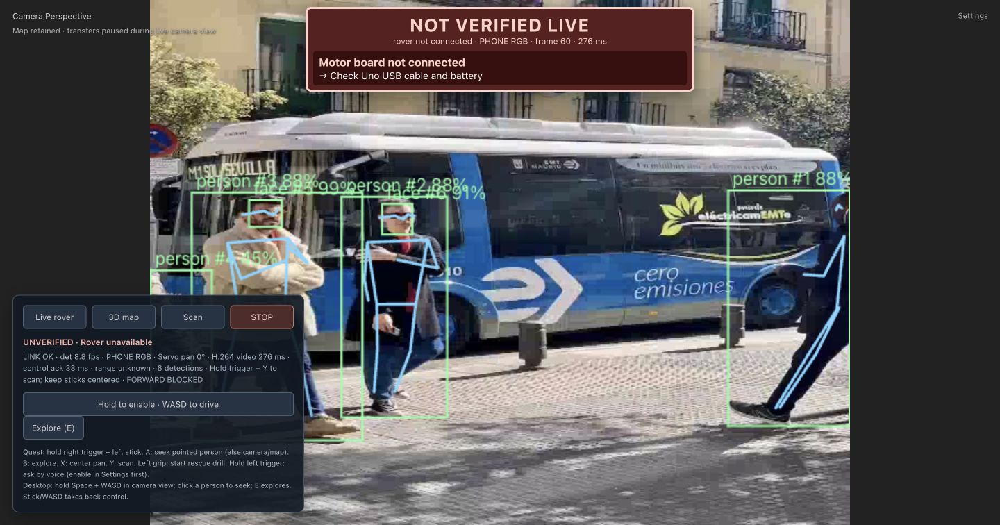

# Physical Jetson application setup — October 10, 2026

Godlydonuts’s Codex agent provisioned the recovered Orin Nano over USB SSH.
OS and USB recovery evidence is in `jetson-recovery-results.md`.

## Verified on the board

- Source deployed to `/home/ubuntu/farsight`; Python 3.12 virtual environment
  includes system packages so NVIDIA TensorRT bindings remain accessible.
  Application snapshot `8522c8e` includes the cellular map budget and detection
  matching improvements; its viewer build and 89 tests passed, along with 28
  mapping/budget/proxy checks and the 13-step simulated/replay judge flow.
- ARM64 runtime wheels installed from `/home/ubuntu/farsight-wheelhouse` with
  `--no-index`. Imports passed for OpenCV 4.14, FastAPI 0.143, ONNX Runtime
  1.31, NumPy 2.5.3 and aiohttp. Models copied separately: detection, pose,
  UltraFace, SmolVLM plus projector, Whisper tiny.en and Piper low voice.
- `farsight.service` is enabled and serves HTTP on USB address
  `http://192.168.55.1:8443`. Configuration is `/etc/farsight.env`, with phone
  input, physical serial unset, target-built pose TensorRT and H.264 enabled. TLS is omitted
  for this USB bring-up; operator relay provides the Quest-facing origin.
- `/health` loaded pose ONNX without detector error and reported camera
  `WAITING`, rover disabled, estop true and release required. No camera,
  `/dev/ttyACM*` or `/dev/ttyUSB*` device was present during this check.
- Added `ubuntu` to `dialout` for subsequent Arduino attachment; systemd
  already includes the group explicitly.
- A static public photo sent over USB through `/phone/rgb` produced pose
  inference and H.264 initialization plus a requested media segment (10,818
  binary bytes). This exercised the real board's phone-protocol/encoder path,
  not actual iPhone capture. After disconnect, camera freshness expired,
  rover remained disabled and estop remained true.
- Native ARM64 Whisper CPU binaries were compiled on the board. Piper
  generated a 1.952-second, 16 kHz mono WAV; Whisper tiny.en transcribed
  “foresight is ready for the rover test.” from the generated speech.
  This is a local synthesis/transcription check, not microphone qualification.
- CUDA 13.2 runtime initialized device 0; TensorRT 10.16.2.10 imported.
  NVCC 13.2 and cuBLAS development libraries are installed. Pose and COCO
  target-built engines passed actual CUDA execution. The demo is vision only:
  native voice builds were stopped and optional LLM/Whisper services disabled.
  Installed voice artifacts are unused and are not demo readiness requirements.
- Tailscale 1.104.1 and `iproxy` are installed. Tailscale used the official
  [Ubuntu Noble signed package source](https://pkgs.tailscale.com/stable/#ubuntu-noble).
  Tailnet authentication and phone cellular transport remain pending.
- The 775 MiB source/model transfer bundle verified on the Jetson: source
  `ef33912`, 266 files, 812,192,417 payload bytes. It includes metric depth,
  pose/detection and selected local voice/vision models. Native engines and
  runtime installation remain separate from this portable bundle.

## Actual GPU and browser evidence

### Actual native phone capture

The signed, trusted iPhone 17 Pro app connected directly over USB tethering to
`ws://172.20.10.3:8443` (the actual DHCP address, rather than the app's `.2`
default). Native ARKit RGB-D produced real camera images, normal tracking,
120,000 mapped points and measured depth. A JPEG was fetched and visually
inspected; H.264 was ready and pose TensorRT detections were running. The
[health snapshot](qualification/jetson-phone-live.json) records the observed
accumulated counts after the operator intentionally stopped capture. Motors
were absent and estop remained true.

The human confirmed the stream ended because they tapped Stop; USB networking
remained active. This proves real phone ingestion, not sustained rig qualification
or physical camera-to-eye latency. The Jetson desktop now displays the raw
MJPEG camera stream, avoiding a second 3D renderer on the rover GPU.

Target-built FP16 pose raw inference `[1,56,8400]` passed 20 zero-input runs:
median 15.29 ms, p95 18.83 ms. COCO `[1,84,8400]` passed the same smoke:
median 11.66 ms, p95 21.44 ms. Pose also detected four people on the public
test photo. These measurements occurred under concurrent native-build load;
they measure engine execution rather than camera-to-eye latency.

The real Jetson GPU pose, phone-input protocol, USB commissioning link and
production Mac operator viewer rendered H.264, green boxes and blue skeletons.
Detector samples were around 7.5–8.9 FPS while native builds continued.
The image below uses a public static photo, **not an attached phone camera**.
The banner correctly reports the disabled motor board and unverified live rig.

An isolated source drawing trace observed 172 box/skeleton phases and zero
paints with invalid metadata. That trace used an instrumentation wrapper;
the screenshot above was taken from the production bundle.

A writer-only temporary aiohttp producer originally disconnected after 40
seconds: it did not call `receive()`, so it failed to answer the server's PING
and received `1011: keepalive ping timeout`. The corrected producer used a
concurrent receive loop, answered both pings, delivered 558 static-photo frames
over 57 seconds and intentionally closed both sockets normally (`1000`).
The iOS client already has a receive loop. No runtime timeouts were loosened.

## Software H.264 repair

The NVIDIA `ffmpeg` 8.0.1 package disables GPL encoders, including `libx264`.
The Orin Nano demo needs software encoding. Ubuntu FFmpeg 6.1.1 and its
versioned libav libraries were downloaded as packages and extracted into
`/home/ubuntu/farsight-ffmpeg`, preserving NVIDIA's installed libraries.

`/home/ubuntu/.local/bin/ffmpeg` sets `LD_LIBRARY_PATH` to that extracted
library directory and executes its FFmpeg binary. The systemd drop-in
`/etc/systemd/system/farsight.service.d/ffmpeg.conf` puts that wrapper first
on the service's PATH. A real 640×480, 10 FPS red-frame libx264 encode
produced `/tmp/farsight-encoder-smoke.mp4` successfully. This qualifies the
encoder, not phone capture or Quest playback.

The reusable `jetson/install_software_ffmpeg.sh --install-service-path`
subsequently passed its encoder and encode checks on this board, reused the
working private prefix and installed `software-ffmpeg.conf` without restarting
the service. See `software-ffmpeg.md` for repeating this setup.

## Metric depth preparation

The pinned official metric indoor model was exported on the Mac and copied
over USB. The exact ONNX SHA-256 is
`7ba4679f646ac5af720a565727cc8352ccb58a52dfc65fceb5874f8ed880190e`.
Both `jetson.tests.test_scan.DepthModelTests` passed against this actual model
on Jetson ONNX Runtime, including ImageNet normalization and preserving metric
output. The reproducible exporter and provenance are documented in
`models/README.md`. Physical room accuracy and target TensorRT execution remain
separate checks.

## Installation transport and remaining qualification

### Desktop baseline, camera waiting

An 11-sample, one-second `tegrastats` capture with Firefox's live viewer open,
camera `WAITING`, no motors configured, and no native model builds running is
saved in [the raw log](qualification/jetson-desktop-waiting-tegrastats.txt).
The board was in its existing 25 W power mode. RAM was 2,922–2,926 MiB of
7,486 MiB; CPU cores reported 11–33% utilization, GPU utilization 18–37%,
GPU temperature 44.9–45.2 °C and board input power 4.84–4.96 W.
These include the desktop/browser and background services; they are not
inference utilization, isolated GPU memory, or full-rig power measurements.
Repeat with actual phone capture and navigation before choosing their budgets.

An SSH remote SOCKS proxy bound only to Jetson loopback port 18083 routes
installation downloads through the Mac's internet connection. APT calls
explicitly select that proxy; the application does not depend on it.
Ubuntu's empty sources file was restored from its installer backup and the
stale installation-media source disabled. No distribution upgrade or
autoremove was run.

Metric-depth TensorRT execution remains unqualified; measured iPhone LiDAR does
not depend on that optional model. The iPhone capture app has been signed,
installed, trusted and launched. Actual phone RGB-D capture over USB and an
operator-initiated stop/restart have now worked; sustained performance and
sensor-to-display latency remain unqualified. Cellular routing, Quest USB/browser,
actual motor direction/PWM, watchdog disconnects and power under load must
still be verified on the complete rig. Compatible SciPy and cffi wheels were
installed in the venv to resolve inherited system-package constraints;
`pip check` now reports no broken requirements.
