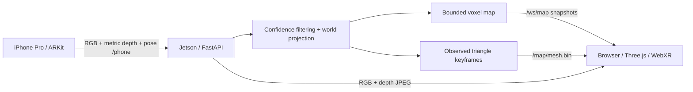

# RGB-D reconstruction and recon viewer

## What runs where

The iPhone supplies synchronized ARKit RGB, LiDAR depth, depth confidence, and camera-to-world transforms.
The Jetson runs `jetson.server`: it projects measured samples, averages nearby points in 4 cm voxels,
keeps observed triangle keyframes, and serves the browser. The browser renders Three.js geometry and live camera/depth views.
No neural model, TensorRT engine, API key, or depth estimation is required for this phone path.
The optional [camera-only stationary scan](scan.md) uses local metric depth estimation
and replaces the same point map/viewer; it does not mix camera scans with phone origins.



## Start on the Jetson

From the repository root, install dependencies and build the viewer as described in the README.
Then:

```bash
.venv/bin/python -m jetson.server --host 0.0.0.0 --port 8443
```

In the existing Pip Scout phone app, point the backend at `ws://JETSON_IP:8443/phone`.
Use its native landscape-right, same-frame LiDAR stream. The phone must support ARKit scene depth;
a browser camera stream by itself supplies neither LiDAR depth nor ARKit world pose.
Use a new phone session ID / map epoch whenever ARKit's world origin resets.
The server accepts one phone at a time; live phone connections are refused in demo mode.

Open `http://JETSON_IP:8443` on a laptop or the Quest browser for the ordinary view.
The full-screen viewport follows the visual direction of Pip Scout's
[`sais-ideal-dashboard-type-shi` branch](https://github.com/azizu06/pip-scout/tree/sais-ideal-dashboard-type-shi):
neutral gray, subtle grid/axes, a small status line, and keyboard navigation hints.
Right-drag orbits, left-drag pans, scroll zooms, F frames the scan, P switches points/hybrid,
and Home resets the view. Arrow keys pan, Shift+arrows rotate, and +/- zoom.
Escape or Settings opens the optional panel for RGB/depth feeds, 3D/2D/Camera modes,
camera following, pause, reset, PLY export, and VR entry.
Pause leaves camera/pose observation running. Export includes the current bounded point map.
Reset clears observed geometry but keeps the phone's current ARKit world origin.

### Quest immersive mode

WebXR requires a secure context. Serve the built page and WebSocket from the same trusted HTTPS origin:

```bash
.venv/bin/python -m jetson.server --host 0.0.0.0 --port 8443 \
  --ssl-certfile /path/to/trusted-cert.pem --ssl-keyfile /path/to/private-key.pem
```

Use `wss://HOST:8443/phone` in the phone app and `https://HOST:8443` in Quest Browser.
The certificate must be valid and trusted on both devices; a laptop's localhost exception does not make a LAN IP secure.
An existing HTTPS reverse proxy on the LAN is also suitable if it forwards WebSocket upgrades.
The viewer's VR button detects immersive support and enters a 1:1 map inspection scene.
It starts at the streamed camera's X–Z position, with local-floor height at Y = -0.5 m as an initial inspection offset.
The viewport's origin grid is a display aid, not a calibrated physical floor or a navigation clearance surface.
Desktop layout, feeds, and map controls are verified locally; headset entry and real sensor behavior need the physical rig.

## Input compatibility

Input follows the [Pip Scout interfaces](https://github.com/azizu06/pip-scout/blob/main/docs/INTERFACES.md).
This is protocol compatibility, implemented here independently.

1. Connect `/phone` and send a JSON hello: `version: 1`, `type: "hello"`, `session_id`, `map_epoch`,
   `device`, `supports_scene_depth: true`, and optional `supports_mesh`.
2. Optionally send v1 JSON `pose` updates, with identity, frame ID, capture time, tracking, and transform.
3. Send binary v1/v2/v3 `frame` bundles:

```text
uint32 little-endian header byte length
UTF-8 JSON header
JPEG bytes
float32 little-endian optical-axis depth in metres, row-major
uint8 confidence (0 = low, 1 = medium, 2 = high), row-major
```

The header includes:

```json
{
  "version": 1, "type": "frame", "session_id": "your-ar-session", "map_epoch": 1,
  "frame_id": 42, "t_capture": 12.3, "t_wall_ms": 1791620000000,
  "tracking": "normal",
  "transform": [1,0,0,0, 0,1,0,0, 0,0,1,0, 0,0,0,1],
  "image": {
    "width": 960, "height": 720, "jpeg_len": 10000,
    "intrinsics": [800,0,0, 0,800,0, 480,360,1], "orientation": "landscape_right"
  },
  "depth": {"width":256,"height":192,"format":"float32_m","len":196608},
  "confidence": {"width":256,"height":192,"format":"uint8_0_2","len":49152}
}
```

The example `jpeg_len` must be replaced with the actual byte count. Intrinsics describe the transmitted JPEG.
Image and depth must have the same aspect ratio; cropped, rotated, or independently zoomed images are rejected.
**Mount orientation.** The rover phone may sit either way up in its landscape cradle. ARKit frames are sensor-native, so
the Jetson (`jetson/mapping/orientation.py`) reads gravity from each frame's camera pose: when world-up in the camera's image
plane points down for 3 consecutive frames (past 110 degrees; back at 70 degrees with the same hysteresis, held while the camera
looks within ~20 degrees of straight up or down) it rotates JPEG, RGB, depth, confidence, principal point and pose by 180 degrees
before anything else sees the frame. `/camera.jpg`, the video lane, detector boxes, person markers, SBAR/identity crops, the dense
map and Nav2 therefore stay upright with no phone change, and fusion receives identical world points either way up, so
nothing is corrected twice. Frames carry `orientation_normalized: "rotated_180"` while rotated. Phone RGB-only frames have no
pose, so this path covers the LiDAR rover phone only; the Rust server does not normalise yet.

ARKit optional floor and mesh metadata on v2/v3 bundles is accepted but not used to fabricate geometry.
In phone mode, only measured RGB-D creates this map. Full ARKit mesh archives, object detection, and old rover relay messages
are outside this mapping server's protocol.

### Coordinates

Both matrices use column-major wire order. ARKit camera coordinates have X right, Y up, and the view down **negative Z**.
A native sensor pixel `(u,v)` with depth `d` projects to:

```text
camera = [(u - cx) * d / fx, -(v - cy) * d / fy, -d]
world  = camera_to_world * [camera, 1]
```

All new map outputs are **ARKit world coordinates, Y up, metres**, matching Three.js directly.
This is distinct from the existing experimental OpenCV webcam helpers and the earlier rover-local
`/ws/points` contract in `docs/interfaces.md`. The new viewer uses `/ws/map`; this server leaves `/ws/points` unimplemented.
The top-down view is an observed geometry projection, not an occupancy planner or evidence that a route is clear.

## Output endpoints

| Endpoint | Response |
| --- | --- |
| `GET /` | Built `quest/dist` viewer |
| `GET /health` | Sensor freshness, tracking, map counts, pose, timing, session, map generation |
| `WS /ws/map` | JSON status, then full binary point snapshot when revision changes; 2 Hz |
| `GET /map/points.bin` | Current full point snapshot |
| `GET /map/mesh.bin` | Full bounded surface snapshot |
| `GET /camera.jpg` | Latest validated same-frame RGB JPEG |
| `GET /depth.jpg` | Depth heatmap; turbo color scale, 0.15–8 m valid range |
| `GET /stream.mjpg` | MJPEG from received camera frames |
| `POST /map/pause` | `{"paused": true}` or `{"paused": false}` |
| `POST /map/reset` | Clear observed map and increment viewer generation |
| `GET /map/export.ply` | Binary little-endian XYZ/RGB point cloud |

Point packets: `uint32 count`, then `count` records of `(float32 x,y,z, uint8 r,g,b,pad)`.
Surface packets: `uint32 vertex_count`, `uint32 index_count`, the same 16-byte vertex records,
then `index_count` little-endian uint32 triangle indices. Three indices make one triangle.
Binary packets are complete replacement snapshots. Reconnects receive current state; the viewer never appends duplicates.
Every map reset increments `generation`, and all surface and point caches must be cleared together.
`processing_ms` measures the latest successful fusion computation; it is not network latency or camera capture FPS.

`--fusion-bypass` (`FARSIGHT_FUSION_BYPASS=1`, same name in the Rust server) skips the voxel and
surface fusion on the Jetson, for when the 3D mesh is built elsewhere. Every accepted `/phone`
frame still publishes the camera, the depth view, `depth_range` and the ARKit pose. Each frame
also still reaches the Nav2 depth observer; the sensor gate and LiDAR drive rules are unchanged.
Status (and `/health`) then reports `fusion_bypass: true`. `points`, `triangles`, `keyframes`
and `frames` stay `0` and `revision` stays unchanged. `reason` is `"Geometry lane external;
fusion bypassed"`.

## Bounded reconstruction

- Points: 120,000 recent spatial voxels at 4 cm; repeated observations update their average color and position.
- Surfaces: 160,000 triangles maximum. Store a new keyframe after 18 cm translation or 14° rotation;
  evict the oldest when the budget is reached. Overlapping keyframes remain separate measured surfaces.
- Reject nonfinite/out-of-range depth and low-confidence samples. Discontinuity filtering and triangle depth checks
  prevent connecting foreground and background surfaces across depth gaps.
- Freeze fusion on `limited` / `not_available` ARKit tracking. Never silently invent camera motion.
- A one-frame mailbox drops superseded queued frames so CPU fusion cannot build an unbounded application backlog.
- Preserve the map on disconnect and reconnect to the same phone session/epoch. Clear it for a new world origin.
- Maps are in memory, and the server does not persist scans across restarts. Export before stopping.

This is observed RGB-D reconstruction. It is not a watertight scan, TSDF integration, or a loop-closing SLAM system.
ARKit provides pose tracking; its drift, LiDAR noise, transparent surfaces, and moving objects remain hardware limitations.
The previous webcam odometry modules are preserved as experimental helpers and are not used by this iPhone pipeline.

## Simulator and checks

`--demo` ray-casts colored walls, a floor, and box obstacles at 160×120 depth resolution,
with a camera following a slow translated/rotating path. Its measured synthetic depths use the same projector,
voxel map, surface builder, delivery format, and viewer as the phone. It does not emulate motor motion or ARKit tracking failures.
The unit suite separately checks invalid packets, transform handedness, projection signs, confidence,
depth boundaries, bounded maps, pause/loss behavior, reconnects, binary delivery, and export.
