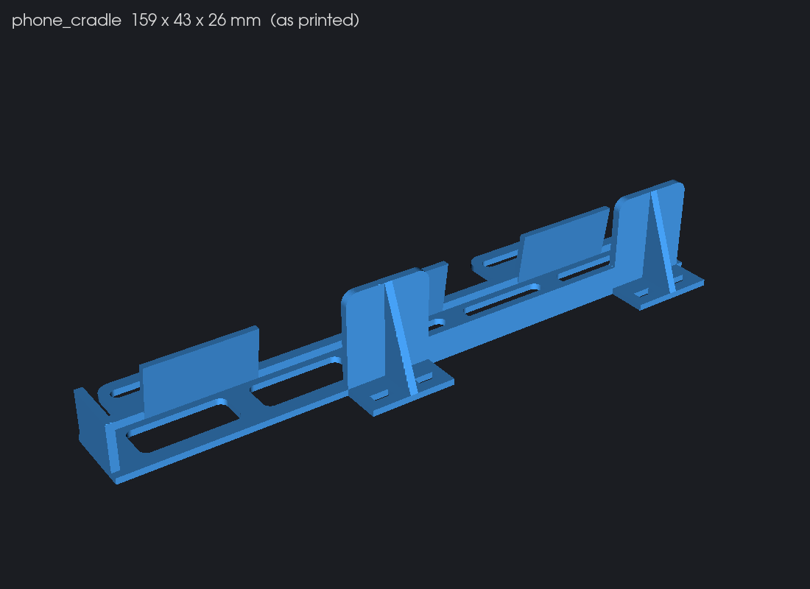
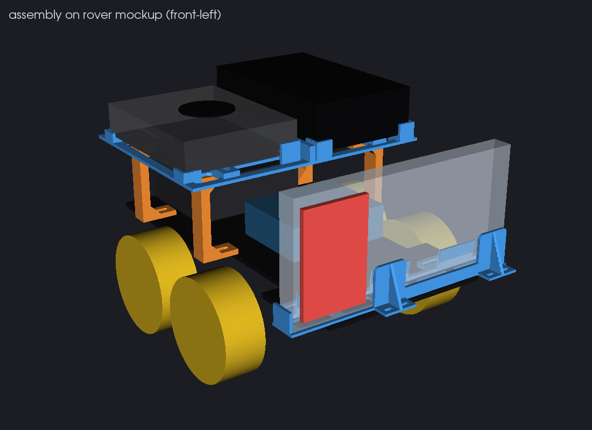
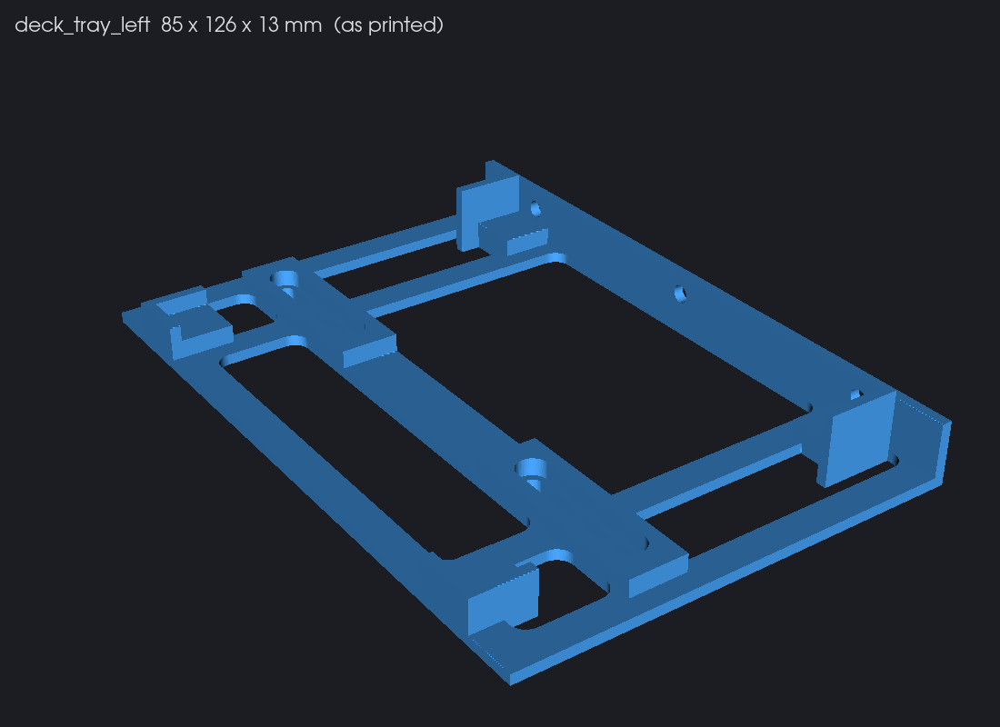
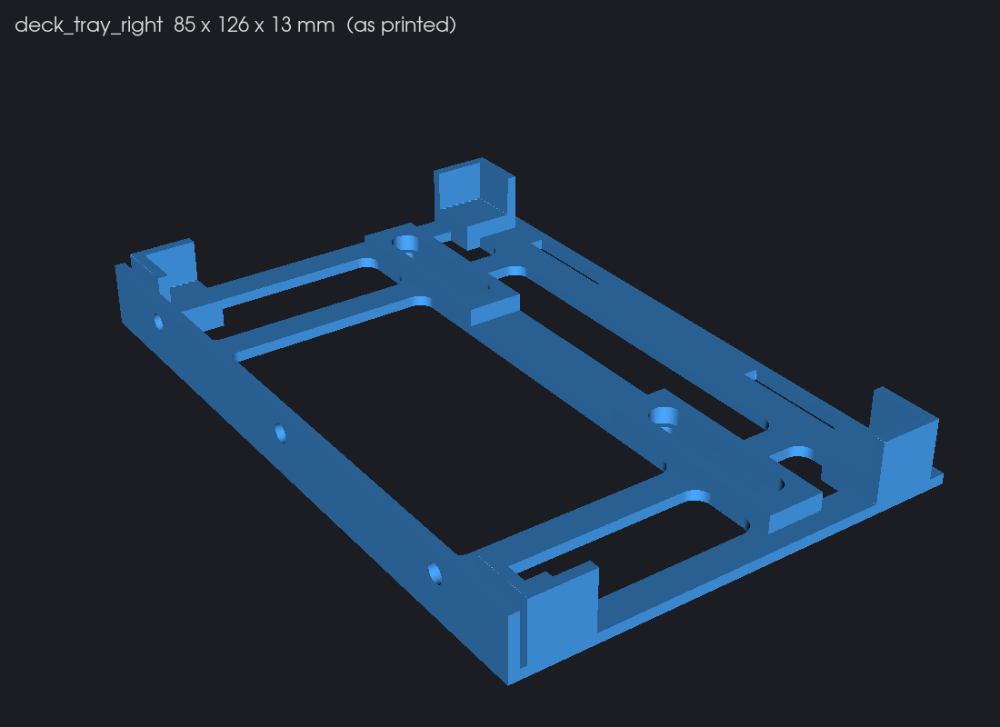
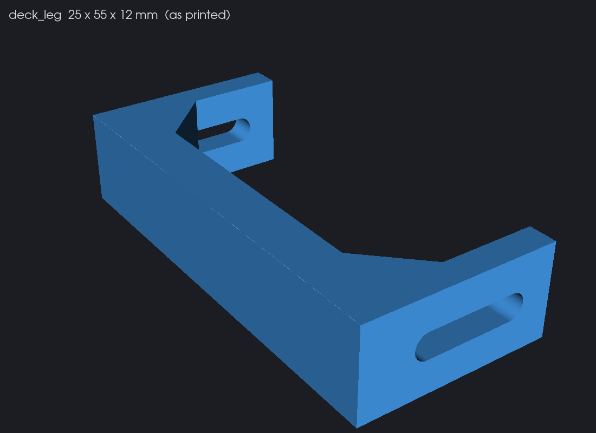
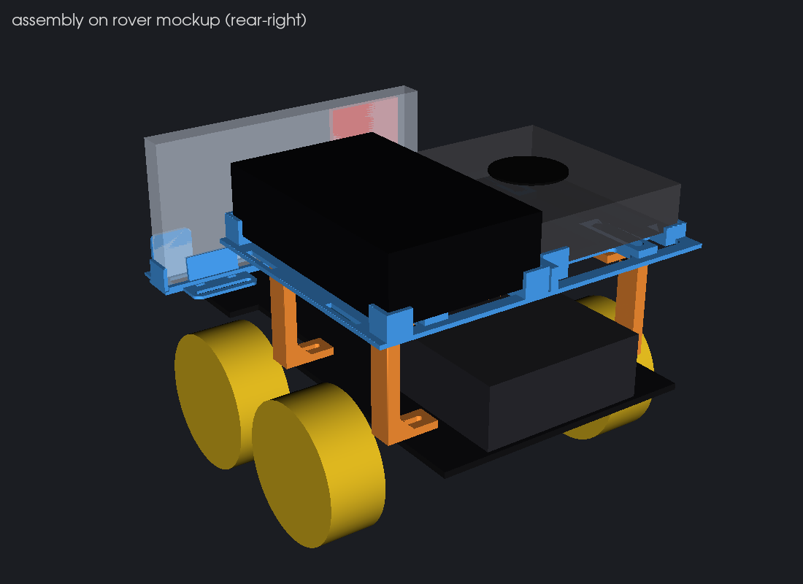
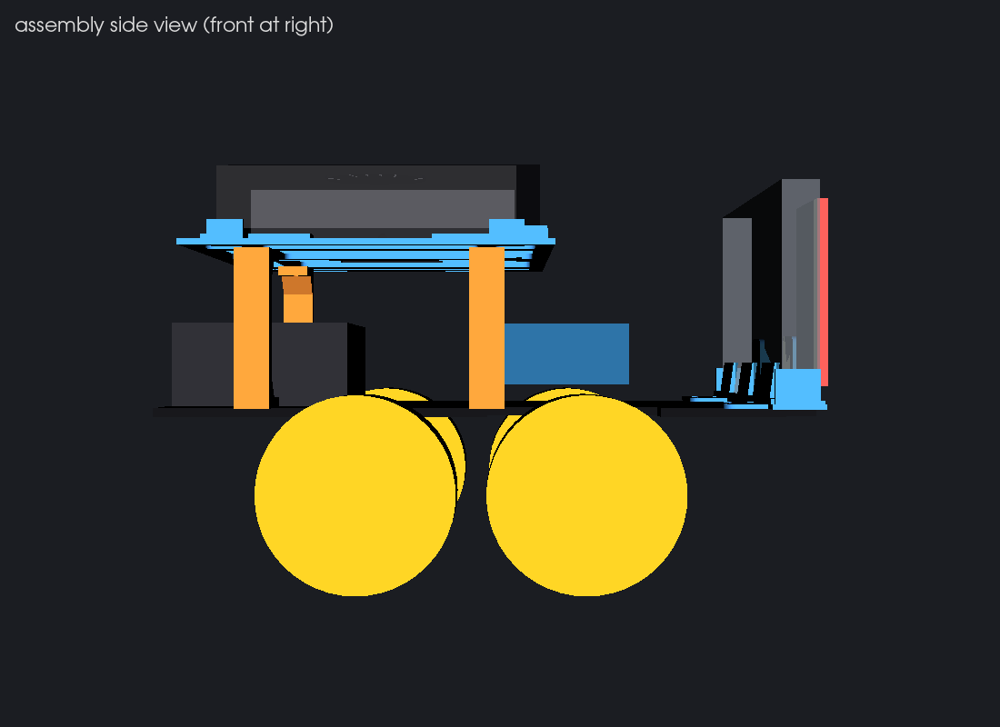

# Printed rover mounts

Two printed assemblies replace the stacked parts on the ELEGOO Smart Robot Car V4:

- **Phone cradle**: holds the LiDAR iPhone 17 Pro (clear case) in landscape at the front of the top plate.
- **Upper deck**: a shelf over the Uno and shield. It carries the Jetson Orin Nano Super dev kit and the Anker Zolo 20K bank side by side.

The phone faces forward with nothing in front of its camera plateau. The bank sits on the deck, so the 2x18650 switch stays reachable at the rear.

Every part fits a single print under 55 min on a modern printer, so it qualifies for the event's 60-minute limit. Every footprint fits a 180 x 180 mm bed (Bambu A1 mini) and a 220 x 220 mm bed.

| Print job | STL | Bambu A1 PETG | Bambu A1 PLA | Prusa MK4S PETG | Filament |
|---|---|---|---|---|---|
| Phone cradle | `stl/phone_cradle.stl` | 54 min, 15.1 g | 43 min, 13.8 g | 38 min, 14.1 g | **Black PETG** |
| Deck, Jetson half | `stl/deck_tray_left.stl` | 45 min, 16.1 g | 38 min, 15.1 g | 38 min, 16.0 g | Black PETG (or PLA) |
| Deck, bank half | `stl/deck_tray_right.stl` | 51 min, 18.8 g | 44 min, 17.9 g | 46 min, 18.9 g | Black PETG (or PLA) |
| Deck legs, 4 copies in one job | `stl/deck_leg.stl` x4 | 43 min, 15.6 g | 38 min, 15.7 g | 38 min, 15.6 g | Black PETG (or PLA) |

The four jobs total about 66 g of PETG.

The times come from the slicers' own estimates. The settings were stock 0.20 mm presets, 0.4 mm nozzle, 2 walls and 15 % infill. Run `python3 hardware/print/slice.py` to repeat them. Notes on the estimates:

- **Bambu A1.** The times are OrcaSlicer's "model printing time". The printer adds about 6 min of bed levelling and calibration before it starts.
- **Older printers.** On a printer without input shaping, such as a Prusa MK3S or an Ender 3, every job runs 80-100 min. If the event's printers are that slow, ask for 0.28 mm layers.
- **The cradle.** It is the tightest job on the Bambu with PETG, because PETG's 12 s minimum layer time dominates the thin uprights. If that printer quotes over 55 min, print the cradle in PLA (43 min).

Print every STL exactly as exported, with no supports. The legs print lying on their side.

Previews (as printed, plus the assembly on a box mockup of the rover):

| | |
|---|---|
|  |  |
|  |  |
|  |  |
|  | |

## Dimensions used

| Item | Value | Source |
|---|---|---|
| iPhone 17 Pro | 150.0 x 71.9 x 8.75 mm, plus 2 mm per side for the clear case | [Apple tech specs](https://support.apple.com/en-us/125090) |
| Jetson Orin Nano dev kit | 100 x 79 x 21 mm (height includes feet, board, module and thermal solution) | NVIDIA dev kit datasheet, quoted in [NVIDIA forum: mechanical dimensions](https://forums.developer.nvidia.com/t/mechanical-dimensions-jetson-orin-nano-development-kit/316529) |
| Anker Zolo 20K 45 W, built-in dual USB-C (A110M) | 119.9 x 73.4 x 31.4 mm | [retailer spec sheet](https://openelab.io/a/s/products/anker-20000mah-power-bank-pro). [Anker Japan](https://www.ankerjapan.com/products/a1689013) rounds this to about 120 x 70 x 30 |
| ELEGOO V4 top plate, standoffs, Uno height | estimated from team photos (Uno 68.6 mm board as the scale) | no official plate drawing or community model found |

NVIDIA does not publish a mounting-hole pattern for the dev kit carrier. NVIDIA's forum confirms this: the carrier spec omits hole positions, and the dev kit is screwed to its own plastic base ([thread](https://forums.developer.nvidia.com/t/jetson-orin-nano-carrier-mechanics/339279), [thread](https://forums.developer.nvidia.com/t/how-to-mount-the-orin-nano-dev-kit/278706)). The deck therefore holds the dev kit by the outline of that base:

- The flange on the inboard side.
- End stops at both ends.
- Two 3 mm corner tabs on the port side, low enough to pass under the connectors.

All ports and the barrel jack face outward to rover-left, and the fan is open above.

### What depends on the rover estimates

No official ELEGOO V4 plate drawing turned up, so every interface with the plate is slotted or adjustable. The table lists what each estimate is and how much error each interface absorbs.

| Estimate (`build.py`) | Value | Error absorbed |
|---|---|---|
| Middle and rear standoffs, across | about 112 mm apart (`STANDOFF_X` 56) | about 11 mm. The foot slot and top slot each give 5.5 mm |
| Middle-to-rear standoff pitch | about 80 mm (`STANDOFF_PITCH`) | 12 mm per leg. The deck nut channels give 24 mm of travel |
| Front "ear" standoffs, across | about 104 mm (`EAR_STANDOFF_X` 52) | 14 mm per side, from 28 mm transverse slots. The cradle slides fore-aft to meet them |
| Shield and JST header top above the plate | 30 mm (`SHIELD_TOP`) | the deck underside sits 25 mm above it (legs 55 mm) |

No ruler measurement is required before printing. One check is worth 30 seconds if a ruler is at hand: the center-to-center distance across the rover between the two middle standoffs, the pair just behind the front wheels. If it falls outside 92-132 mm, change `STANDOFF_X` and rebuild.

## Phone cradle

How the phone sits:

- **Orientation.** The phone stands landscape on its long edge, back toward the scene. The camera plateau is at the rover-left end with the lenses at the top, and USB-C is at the rover-right end.
- **Camera end.** Nothing is in front of the back plane for the first 52 mm at that end (`CAM_CLEAR`). The 17 Pro plateau spans the full width of the phone, so both back uprights sit on the USB half.
- **Grip.** The channel is 13.55 mm wide: the 12.75 mm cased phone plus 0.8 mm of play. Three screen-side PETG fingers lean in 2 mm and squeeze the phone against the uprights, which removes the wobble. If a slimmer case rattles, put a strip of foam tape on the fingers.
- **Stops and cable.** End stops on both short edges keep the phone from sliding. The USB-C end stop is 12 mm tall, below the port, so a cable plugs straight in.
- **Attachment.** The two ears behind the channel have 28 mm transverse M3 slots for the two front "ear" standoffs. Slide the cradle fore-aft until the slots line up with them. If the screws don't line up, use the zip-tie slots: 4 in the ears and 4 in the upright feet, which sit over the plate tip and the old servo slot.

To fit it:

1. Remove the screw in each front ear standoff.
2. Set the cradle on the plate with the phone back plane about 3-5 mm behind the plate tip.
3. Refit the screws through the ear slots with M3 x 8 screws and washers. The kit's original screws are too short to reach through the extra 1.6 mm floor.

## Upper deck

Two halves, bolted together through their divider flanges with three M3 x 8 screws and nuts:

- **Left half (Jetson).** Pocket of 80.5 x 101.5 mm on 3.4 mm pads.
- **Right half (bank).** Pocket of 74.9 x 121.5 mm with corner posts and both ends open for the built-in cables. Two 20 mm velcro straps go through slots on both long sides of the bank.

Velcro dots under both devices are recommended.

The deck sits centered between the middle and rear standoffs, from about 92 mm to 218 mm behind the plate tip, with its underside 55 mm above the plate. It covers the front of the battery box with about 25 mm to spare above the box. The box's rear face, with its switch, sits about 7 mm behind the deck's rear edge, so the switch stays reachable.

Four C-shaped legs carry the deck:

- The column sits outboard and both pads reach inward.
- The foot pad screws onto a top-plate standoff with M3 x 10 through a 3.6 mm pad and the acrylic.
- The top pad bolts into a sliding nut channel in the deck boss. Use M3 x 8 from below with the nut dropped into the channel from the top, or M3 x 10 from the top with the head in the channel and the nut under the pad.
- Rear legs: keep the pads clear of the battery box. With the screw mid-slot, the pad's inner end reaches 11 mm inboard of it.

To assemble:

1. Bolt the two deck halves together.
2. Screw the four legs to the middle and rear standoffs. Leave the screws loose.
3. Lower the deck onto the legs, then slide the nuts and slots until all four screws drop in.
4. Tighten everything.
5. Strap the bank, then set the Jetson in its pocket with its ports facing out.

## Hardware

- M3 x 10 screws: 4 (leg feet), plus 4 for the leg tops if they go in from the top
- M3 x 8 screws: 2 (cradle ears) and 3 (deck join), plus 4 for the leg tops if they go in from below
- M3 nuts: 7
- M3 washers: 6 (on the slots)
- 20 mm velcro strap: 2
- Velcro dots
- Zip ties up to 4.8 x 2.0 mm, as a fallback

## Rebuild

```sh
# CAD, renders (VTK ships with CadQuery)
uv run --python 3.12 --with cadquery==2.8.0 python hardware/print/build.py
uv run --python 3.12 --with cadquery==2.8.0 python hardware/print/render.py
# slicer estimates (brew install --cask prusaslicer orcaslicer)
python3 hardware/print/slice.py
```

The OpenSCAD Homebrew cask is disabled (it fails Gatekeeper), so the source is CadQuery. Every dimension is a named constant at the top of each section of `build.py`.

## Status

These parts have been checked in CAD, in renders against a box mockup and in slicer estimates only. They have not been printed or fitted to the rover yet. Record the actual fit, any wobble and the real print times here after the first prints.
